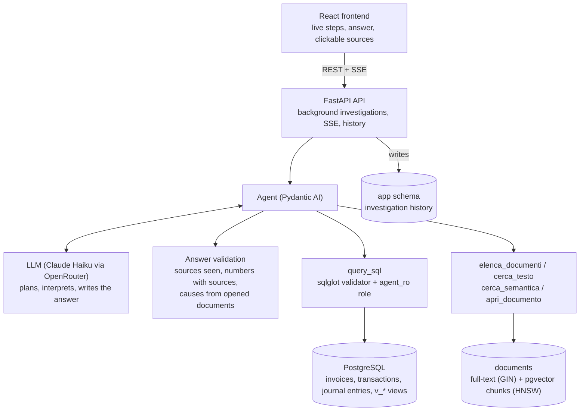

<p align="center">
  
  
  
  
  
  
  
  
  
  
  
</p>

# Agentic Financial Investigation

An AI agent that investigates a company's financial data by combining **deterministic SQL analysis** with **document search**. It finds and explains significant changes, cites its sources, and says so when a cause is not documented.

<!-- TODO: add a screenshot/GIF in docs/img/ and embed it here, e.g. 
     Suggested scene: "Why did the margin drop in August?" → investigation steps → answer with sources. -->

[Example](#example-investigation) · [Why an agent](#why-an-agent-and-not-a-rag-chatbot) · [Architecture](#architecture) · [Design choices](#design-choices) · [Uncertainty](#when-the-evidence-is-missing) · [Evaluation](#evaluation) · [Running locally](#running-locally)

A working end-to-end prototype: database, RAG, agent, streaming API, web interface and evaluation harness. The data is synthetic, and the company, its documents and the agent's answers are in Italian.

## Why I built it

A company's financial information is scattered across structured data (invoices, bank transactions, journal entries) and documents (contracts, emails, letters, minutes). Understanding *why* a number changed means jumping by hand from one source to another.

The project explores one question: **how can an agent investigate data and documents to help a professional understand what is going on, while keeping calculations deterministic and evidence verifiable?**

It does not replace the accountant and does not automate bookkeeping. It prepares a preliminary analysis that the professional can check source by source.

## Example investigation

Question: *"Why did revenue in the last quarter fall compared with the previous one?"*
(real output of one run, from the [public eval report](eval/reports/20261007-173331.md), truncated and translated from Italian)

```
Question
  ↓
v_margine_mensile                → monthly revenue, costs and margin
  ↓
v_economico_mensile (Q3 vs Q4)   → comparison by revenue account
  ↓
SUM(revenue) per quarter         → totals computed by the database
  ↓
invoices per customer, Q3 vs Q4  → the drop is concentrated on one customer (CLI-001)
  ↓
document search                  → customer's notice + contract CTR-008
  ↓
Validated answer (numbers + sources)
```

> **Facts (from SQL):** revenue fell from €270,300.00 (Q3 2025) to €226,500.00 (Q4 2025), **-€43,800.00**.
> **Documented cause:** on 15/09/2025 Barilli Logistica (CLI-001) announced it would bring application development in-house from 1 October, under framework agreement **CTR-008**; the customer's monthly billing drops from about €28,000 to €12,000.
> **Confidence:** high · **Sources:** CTR-008 and the invoices/journal entries returned by the queries.

Every figure comes from the query that produced it; every source is an ID you can open in the UI (invoice, transaction, contract, email, ...). The interface shows the steps in real time: SQL queries run, documents searched and opened, and any answers rejected by the source check.

## Why an agent and not a RAG chatbot

A RAG chatbot always takes the same path:

```
Question → vector search → LLM → answer
```

Here the path depends on what the investigation uncovers:

```
Question
   ↓
Agent (LLM with tools)
   ├── query_sql          metrics, period comparisons, analysis of invoices and transactions
   ├── elenca_documenti   document index by type, period, customer, supplier
   ├── cerca_testo        full-text search (Italian) over title and content
   ├── cerca_semantica    search by meaning (pgvector), always on
   └── apri_documento     reads the full document
   ↓
Structured answer: numbers + sources + confidence + limitations
```

It first compares periods, then finds the line item responsible, then *decides* what to look for in the documents and how: list a customer's or a period's documents, search for exact words, or search for a concept. A question about a supplier's contract skips the monthly comparisons; a question about the margin does not. A tool loop with a per-question request limit (25 by default) handles both cases.

## Architecture



- **Numbers** come only from PostgreSQL, including the views `v_economico`, `v_economico_mensile` and `v_margine_mensile`, which define revenue, costs and margin on an accrual basis.
- **Document search** retrieves context and causes, never figures. Documents are reached only through the dedicated tools, not through `query_sql`, so every access is a tracked step.
- The **LLM** orchestrates and interprets; it does not calculate.
- The agent is **read-only**: it connects with a role that cannot write the accounting data. The only data the application writes is the investigation history, in a separate schema (`app`) that the agent cannot see.

## Design choices

**SQL + RAG.** Metrics are computed deterministically from structured data, not generated by an LLM. SQL answers "what happened?"; documents help answer "why might it have happened?". The prompt forbids mental arithmetic: differences and percentages must be in the query.

**An agent.** Different questions need different paths (metrics only, period comparison, document search, or all of them), and each step depends on the previous result. A fixed pipeline either over-retrieves or skips pieces.

**Read-only, at several levels.** The real barrier is the database: an `agent_ro` role with a 10 s `statement_timeout` and `SET TRANSACTION READ ONLY` on every query. On top sits an sqlglot validator (a single SELECT, no writes, dangerous functions blocked, known relations only) that gives the model clear errors instead of database errors. Investigating the data and changing it are separate responsibilities.

**Verifiable evidence.** Conclusions trace back to source IDs (`FATT-*`, `MOV-*`, `SCR-*`, `CTR-*`, `DOC-*`, ...). The goal is not "the AI says X" but "the AI found X, and here is what it used". The constraint is not only in the prompt: an *output validator* rejects the answer (and makes the model retry) if it cites an ID that never appeared in the tool results, if a number has no source, or if it declares `causa_documentata=true` without citing at least one `DOC-*`/`CTR-*` opened with `apri_documento` (a search snippet is not enough).

**Document search: the agent decides.** Three simple tools instead of a retrieval pipeline. Listing by metadata and full-text search are deterministic (a document is there or it is not, no thresholds); semantic search covers paraphrases. The agent chooses which one to use, just as it chooses which SQL query to write. A hybrid search in a single tool (RRF fusion of full-text and vectors) would be sturdier with a small model, but would hide the strategy inside the tool; the choice and its trade-offs are in the [design document](docs/superpowers/specs/2026-10-16-ricerca-documenti-opzione-a-design.md). How well the two search tools find the right documents is measured by a retrieval benchmark (see [Evaluation](#evaluation)).

**Transparency.** Queries, searches and opened documents are visible events (tool calls, tool results, rejected answers), saved and reviewable.

## When the evidence is missing

The system does not assume that every anomaly has an explanation.

```
Change detected → relevant document found → conclusion + source
                   (causa_documentata = true)

Change detected → listing by counterparty/period and full-text search with synonyms: nothing found
                → the cause is declared undocumented
                   (causa_documentata = false, explanation in "limiti")
```

A real example (same report): a spike in travel costs in November 2025. The agent finds the accounting origin in the data (four train-ticket invoices on account 64.02, €1,750 against an average of €550), then answers that **no document explains the travel** and sets `causa_documentata=false`, with the explanation in `limiti`.

The mechanisms:
- a negative result comes from reproducible searches (a counterparty's documents in a period, a full-text search with the words used, both visible in the steps) that the accountant can repeat;
- when a search finds nothing it says so explicitly and suggests rephrasing before concluding;
- semantic search returns only chunks within a cosine-distance threshold;
- the prompt treats an undocumented cause as a legitimate answer;
- the validator prevents declaring a cause documented without opening a cited document.

This does not guarantee the absence of hallucinations: it reduces the risk and makes errors checkable.

## Evaluation

A harness (`python -m agentic_rag.eval`) runs a set of questions through the same agent as the API and compares the answers with a ground truth:

- **Two question sets**, in four modes: normal, *honest* (undocumented cause), *unanswerable* (the data does not allow an answer) and *regular* (no anomaly).
  - **Development** ([`eval/ground_truth/`](eval/ground_truth/)): 12 questions on 6 "stories", i.e. events buried in the data (price-list changes, losing a customer, spending spikes, ...). They were used to tune the agent, the validator and the harness, so they do not measure anything.
  - **Test** ([`eval/ground_truth_finale/`](eval/ground_truth_finale/)): 50 new questions on the same dataset, written by hand and kept hidden from the development assistant until the experiment was over. The citable result comes only from this set.
- **Ground truth:** for each question, the sources a correct investigation must cite, the SQL query whose values are the expected numerical answer, and the expected behaviour in the honest and unanswerable cases. The expected query runs on an SQLite database built from `data/csv`, independently of the agent.
- **Success:** expected sources cited, expected numbers found in the answer, no cited source that was never seen, correct behaviour in the honest and unanswerable cases; optionally an LLM judge on the cause.
- **Separation:** the agent never has access to the ground truth. Prompt, thresholds and tools are not tuned by looking at the test set.

The public reports of every run (answers, the agent's SQL queries, per-question counts) are in [`eval/reports/`](eval/reports/). The October 2026 reports use `gemini-3.5-flash-lite`, without a judge, with ~9 model requests per question. The agent now runs on Claude Haiku 5.5 and the judge on Claude Sonnet 5.5, both through OpenRouter; the experiment summary reports the actual cost declared by OpenRouter (agent and judge) and the share of input served from the cache.

**Experiments.** Besides a single battery, `python -m agentic_rag.eval.esperimento` runs variants × repetitions × questions (variants are configurations: model, tools).
- Each run is saved as soon as it finishes, and an interruption is resumed by rerunning `esegui` with just `--etichetta` (variants, questions, criterion and timeout come from the manifest).
- A manifest ties the experiment to the code (`src/`) and to the ground truth (hash only), and resuming is refused if they changed.
- Infrastructure errors (network, 429, 5xx) do not count as failures: the combination is retried in a final pass and, if it still fails, it is excluded and reported.
- Comparisons between variants use only the combinations completed in both. With more than 10% excluded (or unbalanced exclusions) the experiment is declared invalid.

Metrics, each with its own denominator and a 95% confidence interval (bootstrap over questions):
- **Task Success Rate**;
- **Answer Accuracy** (LLM-as-a-judge, validated with Cohen's κ on a sample labelled by hand, blind);
- **pass^3** (all three runs correct);
- **Source Citation Recall** and **Numeric Exact Match Recall**;
- **False Acceptance Rate** (causes invented where none is documented) and **False Abstention Rate** (giving up where one is);
- **Guardrail Intervention Rate** (answers blocked by the source validator);
- **Session Evidence Recall** (expected documents actually retrieved);
- tokens, cost and p50/p95 latency per investigation.

Definitions are in the [harness design document](docs/superpowers/specs/2026-10-19-harness-esperimenti-design.md).

### Results on the test set

Experiment `finale`: 50 questions × 3 repetitions, code frozen at tag `eval-v1`, Claude Sonnet 5.5 as judge, no run excluded ([summary](eval/reports/esperimenti/finale/riepilogo.md)).

| Metric | Agent (Claude Haiku 5.5) |
|---|---|
| Task Success Rate | 94.0% [88.0 – 98.7] |
| Answer Accuracy (LLM judge) | 93.3% [87.3 – 98.0] |
| pass^3 (all three runs correct) | 90.0% [80.0 – 98.0] |
| Invented causes (False Acceptance Rate) | 0 out of 29 |
| Source Citation Recall | 100% |
| Numeric Exact Match Recall | 96.8% [90.7 – 100] |
| Session Evidence Recall | 100% |
| Cost per investigation | $0.0047 agent + $0.0050 judge |
| Working time per investigation | p50 29 s · p95 56 s |

95% intervals, bootstrap over questions.

- **Judge:** on 30 answers labelled by hand, blind, agreement is 87% but Cohen's κ is −0.05. That is below the threshold set in advance (0.6), so the judge is not validated and Answer Accuracy should be read with caution. On a later review of the 4 disagreements, the error was in the human labels, and in 3 cases the judge was the stricter one.
- **False Abstention Rate** (66.7%) is not in the table because the metric overstates it. It counts every "undocumented cause" as giving up on a question that has a document among its sources, even when the question asks for a figure rather than a cause (a deadline, an amount). On the questions that really ask for a cause, the agent gives up in 1 run out of 6 ([analysis](docs/superpowers/specs/2026-10-21-percorso-valutazione-openrouter-design.md#analysis-after-the-final-experiment-2026-11-11)).

**Retrieval.** The retrieval benchmark (`python -m agentic_rag.eval.recupero`) measures the two search tools on their own. The query is the text of the question, the relevant documents are the expected ones, and the questions are the 25 test-set questions with documents among their sources ([report](eval/reports/recupero/finale.md)):

| | Semantic | Full-text |
|---|---|---|
| precision@1 | 0.84 | 0.64 |
| recall@3 | 0.93 | 0.74 |
| recall@5 | 0.99 | 0.89 |
| MRR@10 | 0.90 | 0.75 |

On the development set (9 questions, [report](eval/reports/recupero/sviluppo.md)) the two searches are on par. These are component numbers: the agent rephrases its searches and runs more than one.

## Project structure

```
src/agentic_rag/
  agent/    agent, tools, prompt, SQL and answer validation
  rag/      chunking, embeddings, indexing, search
  db/       schema, views, roles, data loading
  api/      background investigations, SSE streaming, opening sources
  eval/     evaluation harness and retrieval benchmark
frontend/   React UI
data/       synthetic accounting CSVs and documents (contracts, emails, letters, minutes), in Italian
eval/       question sets and public reports (private reports are git-ignored)
tests/      unit and integration tests
```

## Running locally

Requirements: Docker, Python 3.13+, Node.js, an OpenRouter key (`OPENROUTER_API_KEY`, for agent and judge) and a Gemini key (`GOOGLE_API_KEY`, for the semantic search embeddings).

```bash
cp .env.example .env                    # set OPENROUTER_API_KEY and GOOGLE_API_KEY; change the passwords if you like
docker compose up -d db                 # Postgres + pgvector
pip install -e ".[dev]"
python -m agentic_rag.db.init --reset   # roles, schema, views, data loading
python -m agentic_rag.rag.indexer       # document chunking + embeddings (uses the Gemini key)
docker compose up                       # DB + API (:8000) + UI (:5173), with hot reload
```

Open http://localhost:5173. Without containers: `uvicorn agentic_rag.api.app:app` (a single worker: investigations live in the process) and `cd frontend && npm install && npm run dev`.

From the command line (the agent works in Italian):

```bash
python -m agentic_rag.agent "Perché il margine è diminuito ad agosto?"
```

<details>
<summary>Database roles, environment variables, API</summary>

Roles: `postgres` (bootstrap only), `agentic_owner` (DDL and loading), `agent_ro` (read-only, used by the agent), `app_rw` (writes the history in the `app` schema, with no access to `public`). On an already initialised database: `python -m agentic_rag.db.init --app-only` (history), `--fulltext-only` (document full-text search) and `--views-only` (financial views), without touching data and embeddings.

Main variables: `OPENROUTER_API_KEY`, `GOOGLE_API_KEY`, `AGENT_MODEL` (default `openrouter:anthropic/claude-haiku-5.5`), `JUDGE_MODEL` (default `openrouter:anthropic/claude-sonnet-5.5`), `AGENT_MAX_REQUESTS` (25), `DATABASE_URL*`, `CORS_ORIGINS`, `MAX_INDAGINI_CONCORRENTI` (3), `LOGFIRE_TOKEN`. See `.env.example`. With Docker the API reaches the DB as `db` (`DATABASE_URL_APP_DOCKER` / `DATABASE_URL_AGENT_DOCKER`, to set only if you changed the passwords).

| Endpoint | |
|---|---|
| `POST /indagini` `{"domanda": "..."}` | starts an investigation, `202 {id, stato}` |
| `GET /indagini?limit&before` | list |
| `GET /indagini/{id}` | status, answer, error, usage |
| `GET /indagini/{id}/eventi` | SSE: replay + live tail (`Last-Event-ID` / `?dopo=<seq>`) |
| `POST /indagini/{id}/stop` | stops the investigation |
| `GET /fonti/{id}` | opens a cited source (fields, linked tables, text, links), read-only |

SSE events: `tool_call`, `tool_result` (counts and IDs only, never rows), `tool_retry`, `risposta_scartata`, and the terminal events `risposta`, `errore`, `interrotta`. An investigation keeps running if the page is closed; on a server restart the ones in progress become `interrotta`.

</details>

<details>
<summary>Tests and evaluation</summary>

```bash
pytest                                  # unit
pytest -m integration                   # needs the database and the index (python -m agentic_rag.rag.indexer)
                                        # does not reindex: about 6 Gemini calls per run
cd frontend && npm test && npm run build

python -m agentic_rag.eval --dry-run            # validates the ground truth without calling the model
python -m agentic_rag.eval --pause 10           # full battery
python -m agentic_rag.eval --ids 1,4 --judge    # some questions, with the LLM judge on the cause

# experiment: create
python -m agentic_rag.eval.esperimento esegui --etichetta esp --variante haiku --ripetizioni 3 --judge
# resume after an interruption: label only (refused with --variante, --ids, --criterio or --timeout)
python -m agentic_rag.eval.esperimento esegui --etichetta esp
python -m agentic_rag.eval.esperimento riepilogo --etichetta esp     # metrics, comparisons, verdict
python -m agentic_rag.eval.esperimento etichette --etichetta esp --campione 30   # private sheet
python -m agentic_rag.eval.esperimento kappa --etichetta esp         # human/judge agreement
python -m agentic_rag.eval.recupero --gt eval/ground_truth_finale --nome finale   # precision@k, recall@k, MRR
```

Options: `--ids`, `--storia`, `--modalita`, `--model`, `--judge-model`, `--pause`, `--timeout`, `--etichetta`, `--gt`, `--out`.
- Network and provider errors are rerun once.
- Exhausted credit or an invalid key (401/402/403) stops both battery and experiment, which can be resumed after topping up.
- A run without a judge verdict stays open and is redone.
- The timeout (300 s of work, rate-limiter waits excluded) counts as an agent failure.

Experiments write to `eval/reports/esperimenti/<etichetta>/` (public) and to `eval/reports/private/esperimenti/<etichetta>/`. Optional per-minute request and token limits: `AGENT_RPM`, `AGENT_TPM`, `JUDGE_RPM`, `JUDGE_TPM`. There are two reports: a public one in `eval/reports/` and a private one (with the ground truth) in `eval/reports/private/`, which is git-ignored.

</details>

## Limitations

- **Synthetic** data: a small made-up company (~300 invoices, ~1,700 journal entries, about sixty documents), built to contain events to find.
- A **prototype**, not production accounting software; no integration with real accounting systems.
- Documents in Markdown; no parsing of PDFs, scans or attachments.
- Reasoning depends on the LLM: the same question can take different paths and conclusions are not deterministic (numbers are, because they come from the queries).
- Evaluation on a single synthetic dataset (62 documents) and with a single model. The 94% on the test set against 67% on the development set suggests that the new questions are easier (ceiling effect).
- The LLM judge is not validated (κ −0.05), and the harness outcomes are heuristics (thresholds in `eval/valutazione.py`) that can penalise correct answers phrased differently.
- The semantic search relevance threshold is calibrated by hand.
- No authentication or isolation between clients.

## Possible developments

- Connectors to real accounting/ERP systems instead of CSVs.
- Human review (human-in-the-loop) to confirm or reject conclusions.
- A broader evaluation, with more runs per question to measure their variance.
- Better evidence ranking (re-ranking) and learned relevance thresholds.
- Authentication and per-tenant isolation.
- More document formats (PDFs, OCR on scans).

## Philosophy

The project explores how to fit an AI agent into a professional workflow: the model investigates and connects information, deterministic systems provide the data and the calculations, and the professional remains responsible for checking and deciding.
