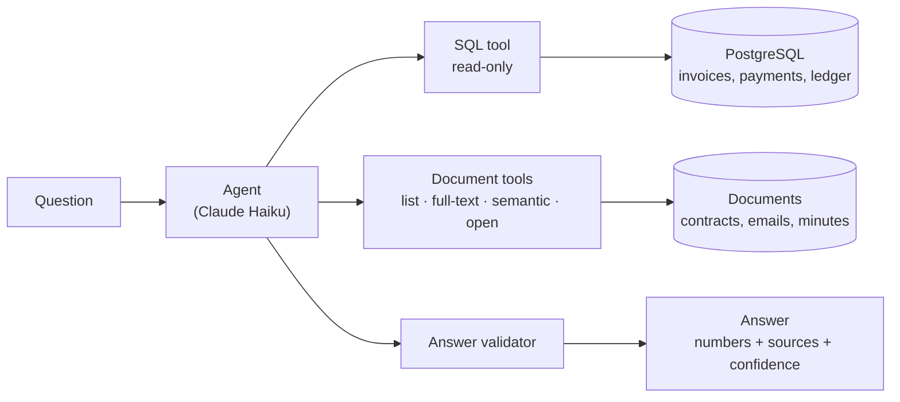

<p align="center">
  
  
  
  
  
  
  
  
  
</p>

# Agentic Financial Investigation

An AI agent that investigates a company's financial data. It combines **SQL queries** for the numbers with **document search** for the causes, cites every source, and says so when a cause is not documented.

It is a working end-to-end prototype (database, agent, streaming API, web UI, evaluation harness) built on synthetic data from a small Italian company.

[How it works](#how-it-works) · [Results](#results) · [Quick start](#quick-start) · [Limitations](#limitations) · [Full reference](docs/usage.md)

## Example

**Question:** "Why did revenue in the last quarter fall compared with the previous one?"

**Answer** (real run, translated):
> **Facts (from SQL):** revenue fell from €270,300 (Q3 2025) to €226,500 (Q4 2025), **−€43,800**.
> **Documented cause:** the main customer announced it would bring software development in-house from 1 October, under framework agreement **CTR-008**; its monthly billing drops from about €28,000 to €12,000.
> **Confidence:** high · **Sources:** CTR-008 plus the invoices and journal entries returned by the queries.

Every number comes from a query, and every source is an ID you can open in the UI. The UI also shows each step live: queries run, documents searched and opened.

## How it works



- **The agent chooses the path.** It compares periods, finds the line item responsible, then decides how to search the documents. A fixed RAG pipeline would always take the same route.
- **Numbers come only from SQL.** The model never calculates; differences and percentages are computed by the queries.
- **Read-only by design.** The agent connects with a database role that cannot write, and every query is checked before it runs.
- **Answers are validated.** An answer is rejected (and the model retries) if it cites a source it never saw, gives a number without a source, or claims a documented cause without opening the document.
- **Honest about gaps.** If no document explains a change, the agent says the cause is not documented instead of guessing.

## Results

Measured on a **test set of 50 questions** written by hand and kept hidden from development until the experiment ended. Each question was run 3 times; an LLM judge (Claude Sonnet) checked the answers.

| Metric | Result (95% CI) |
|---|---|
| Task success rate | 94.0% [88.0 – 98.7] |
| Answer accuracy (LLM judge) | 93.3% [87.3 – 98.0] |
| All 3 runs correct (pass^3) | 90.0% [80.0 – 98.0] |
| Invented causes | 0 out of 29 |
| Sources cited | 100% |
| Numbers matched | 96.8% [90.7 – 100] |
| Cost per investigation | about $0.01 (agent + judge) |
| Time per investigation | 29 s median |

- **Judge reliability:** on 30 answers labelled by hand, agreement was 87% but Cohen's κ was −0.05, below the 0.6 threshold set in advance. Read answer accuracy with caution.
- **Retrieval:** searching the documents with the question text alone, semantic search finds the right document first more often than keyword search (MRR 0.90 vs 0.75, recall@3 0.93 vs 0.74).

Details: [experiment summary](eval/reports/esperimenti/finale/riepilogo.md) · [retrieval report](eval/reports/recupero/finale.md) · [evaluation design](docs/superpowers/specs/2026-10-19-harness-esperimenti-design.md).

## Quick start

You need Docker, Python 3.13+, Node.js, an OpenRouter key (agent and judge) and a Gemini key (embeddings).

```bash
cp .env.example .env                    # add OPENROUTER_API_KEY and GOOGLE_API_KEY
docker compose up -d db                 # Postgres + pgvector
pip install -e ".[dev]"
python -m agentic_rag.db.init --reset   # schema, views, data
python -m agentic_rag.rag.indexer       # index the documents
docker compose up                       # API on :8000, UI on :5173
```

Then open http://localhost:5173. Tests: `pytest` (unit) and `pytest -m integration` (needs the database).

The [full reference](docs/usage.md) covers the command line, the API, the environment variables and how to run the evaluation.

## Limitations

- Synthetic data: one small company, about 300 invoices and 60 documents.
- A prototype, not production accounting software; no authentication.
- Evaluated with one dataset and one model. Scores on the test set (94%) are well above the development set (67%), so the new questions may be easier.
- The LLM judge is not validated, and the scoring rules are heuristics.
